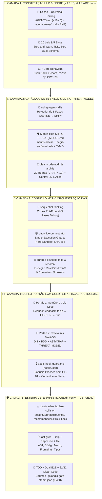
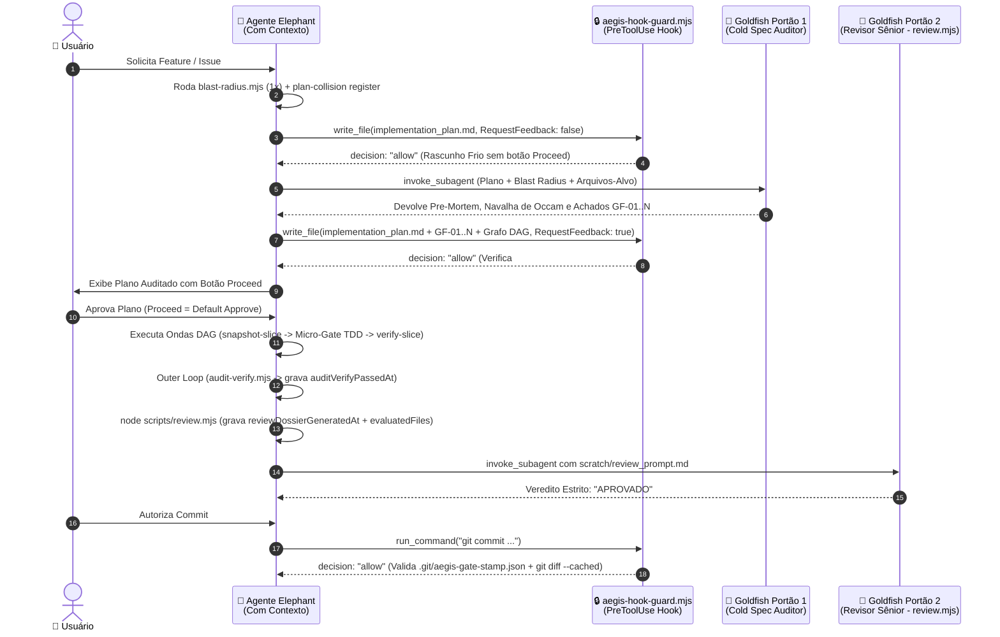

# 🛡️ Apresentação Técnica & Executiva: Aegis Engineering Harness para Desenvolvimento Assistido por IA
### *Arquitetura Reutilizável Multi-Projeto e Multi-Agente: Model vs. Engineering Harness, Constituição Hub & Spoke (`< 22 KB`), Padrão EGM (Elephant-Goldfish) com Protocolo Semáforo, Grafo DAG (`Single-Execution Gate`), Living Threat Model e Esteira de 12 Portões*

---

## 🎯 Slide 1: Abertura Executiva — O Que é um Engineering Harness? (*Model vs. Engineering Harness*)

> *"Um LLM de fronteira é um motor probabilístico de altíssima potência, mas sem freios nativos. Sem um **Harness** (arreio, sensores e trilhos determinísticos), ele corre rápido na direção errada. O **Engineering Harness** não reduz a potência do modelo — ele canaliza 100% dessa força bruta para dentro de barreiras físico-matemáticas onde alucinações, regressões e dívida técnica são fisicamente bloqueadas."*  
> — **Síntese da Tese de Engenharia Agêntica** *(inspirada em **Addy Osmani**, "AI-Assisted Engineering / Beyond Vibe Coding", & **Anthropic Engineering**, "Building Effective Agents" / SWE-bench Agent Harness)*

### A Diferença na Indústria: Prompt Pack vs. Agent Framework vs. Engineering Harness

| Categoria no Mercado | O Que Faz | Limitação / Papel Real |
| :--- | :--- | :--- |
| **1. Prompt / Rules Pack** (`.md` soltos) | Pede boas práticas por texto passivo no início da conversa. | Sofre de truncamento silencioso (`> 24 KB`), esquecimento ao longo da janela de contexto e *self-review bias* (*rubber-stamping*). |
| **2. Agent Framework** (`LangChain`, `CrewAI`, `AutoGen`) | Biblioteca de código para programar chatbots ou fluxos de IA de produto do zero. | Não governa o ciclo de engenharia de software do repositório nem audita commits, AST ou testes. |
| **3. Engineering Harness** (**`Aegis Harness`** — *Padrão Ouro*) | **Constituição *Hub & Spoke* (`< 22 KB`) + 55 Skills + Hooks Físicos `PreToolUse` + Duplo Portão 🐠 Goldfish + Hard Sandbox `SHA-256` + 12 Portões Determinísticos.** | Governa qualquer agente de código (**Antigravity, AWS Kiro, Amazon Q Developer, Claude Code, OpenAI Codex CLI, Cursor, Windsurf, GitHub Copilot**) com bloqueios físicos determinísticos antes do código, entre fatias e antes do commit. |

---

## 🏛️ Slide 2: Visão Executiva — Os 4 Pilares de Engenharia do Aegis Harness

1. **Constituição *Hub & Spoke* (`< 22.000 bytes`) + Tríade `docs/`:**
   - O arquivo [AGENTS.template.md](../templates/AGENTS.template.md) (`< 16 KB`) opera como Hub universal na raiz com a **Seção 0 (`Universal Multi-Agent Routing`)**, roteando sob demanda para regras modulares de domínio em `.agents/rules/*.md` (`< 6 KB` cada, fiscalizadas por `aegis-hook-guard.mjs --check-rules` contra o limite de `24 KB` do Antigravity) e exigindo atualização pré-código da Tríade `docs/PRD.md`, `docs/ARCHITECTURE.md` e `docs/DIRETRIZES_DOMINIO.md`.
2. **Revisão Adversarial EGM (Elephant-Goldfish Model) com Protocolo Semáforo e Hook `PreToolUse`:**
   - **1º Portão (`Cold Spec Review`):** Rascunho frio gravado com `RequestFeedback: false` (sem botão *Proceed*) $\rightarrow$ auditoria pelo subagente **🐠 Goldfish** (memória zero, respondendo ao *Pre-Mortem de Produção* e à *Navalha de Occam*) $\rightarrow$ liberação de `RequestFeedback: true` somente após incluir a tabela `GF-01..N` e o Grafo DAG (bloqueado fisicamente por [aegis-hook-guard.mjs](../templates/scripts/aegis-hook-guard.mjs) em [hooks.template.json](../templates/hooks.template.json)).
   - **2º Portão (`review.mjs` / `review.ps1`):** Obrigatório para 100% dos commits de código (`codeGoldfishRequired: true`), pré-injetando cláusulas BDD Gherkin, resumo do `THREAT_MODEL.md` e telemetria AST/CRAP do `scan-clean-code.mjs`, com Trava Anti-Burla via `git diff --cached` em `.git/aegis-gate-stamp.json`.
3. **Orquestração Reativa por Ondas DAG (`dag-slice-orchestrator` — `Single-Execution Gate Protocol`):**
   - Aloca `100%` dos achados `GF-01..N` em fatias com `Allowed Files Whitelist` disjunta ($\text{Files}(A) \cap \text{Files}(B) = \emptyset$), roteia entre 3 Tiers de Modelo (`flash` / `inherit` / `pro` + *Retry Escalation*) e confina cada `slice-executor` (`EnableMCPTools: false`) com `plan-collision snapshot-slice` e `verify-slice --revert-unauthorized` (`~50ms`).
4. **Qualidade em Tolerância Zero (22/22 Clean Code + Living Threat Model + 12 Portões):**
   - Esteira [audit-verify.mjs](../templates/scripts/audit-verify.mjs) validando lockfile, supply chain, `ast-grep`, `dependency-cruiser`, `knip`, `tsc`, `Archify 3D`, suítes TDD, nomenclatura semântica de testes, `scan-clean-code.mjs --enforce-zero-rules` ($\text{CRAP}(m) < 10$) e sincronia criptográfica `<!-- aegis-surface-hash -->` do [THREAT_MODEL.template.md](../templates/workspace/kb/THREAT_MODEL.template.md).

---

## 🗺️ Slide 3: Arquitetura Geral em 5 Camadas Concêntricas (Defense-in-Depth)

---

## 🚦 Slide 4: Padrão EGM (Elephant-Goldfish), Protocolo Semáforo e Fiscal Nativo (`aegis-hook-guard.mjs`)

---

## 🛡️ Slide 5: Segurança Contínua Shift-Left — Living Threat Model (`THREAT_MODEL.md`) vs. Campanha `mantis-meta-agent`

1. **Modelo de Ameaças Vivo em Cada Issue (`< 20ms` — Regra 1.8):**
   - **Detecção Preventiva no Ciclo 1 (`blast-radius`):** Identifica automaticamente quando arquivos de superfície de ataque são tocados (`securitySurfaceTouched: true`), injetando `relatedDocs: ["workspace/kb/THREAT_MODEL.md"]` e recomendando `mantis-advise`.
   - **Trava Anti-Drift Criptográfica no Ciclo 2 (`<!-- aegis-surface-hash -->`):** Se uma nova rota ou serviço for adicionado sem atualizar a tabela de controles `| TM-* |` em `workspace/kb/THREAT_MODEL.md`, a esteira determinística bloqueia a entrega.
   - **Pré-Injeção no 2º Goldfish e Fim do *Rubber-Stamping*:** `review.mjs` injeta as linhas `| TM-* |` diretamente em `scratch/review_prompt.md`, e o fechamento exige citação nominal dos IDs reais (`[Mantis-Advise]: ✔ THREAT_MODEL.md Consultado (TM-XX: CWE-YY) | ✔ Padrões Defensivos Aplicados`).
2. **Arquitetura `Mantis Hub-Skill` (`consolidateMantisHubSkill`):**
   - Mantém apenas **2 entrypoints** na raiz de `.agents/skills/` (`mantis-advise` para proteção contínua por Issue e `mantis-meta-agent` para campanhas completas de 15 estágios em marcos de arquitetura, com os 17 submódulos organizados em `.agents/skills/mantis-meta-agent/references/`).

---

## 🤝 Slide 6: Portabilidade Universal Multi-Agente (8+ Ferramentas Incluindo AWS Kiro & Amazon Q)

Graças ao padrão **Hub & Spoke (`AGENTS.md` `< 16 KB` + Seção 0 Universal)** e ao bootstrapper [init-harness.mjs](../bin/init-harness.mjs) (`--agent antigravity|claude|codex|all`), o Aegis Harness opera nativamente nas **8+ principais ferramentas agênticas do mercado**:

| Ferramenta Agêntica | Integração Constitucional (`Seção 0`) | Execução de Subagentes e Guardrails |
| :--- | :--- | :--- |
| **1. Google Antigravity / Gemini CLI** | Lê `AGENTS.md` e descobre `.agents/rules/*.md` (ou `.agent/rules/*.md`). | Executa `.agents/hooks.json` (`aegis-hook-guard.mjs`) e `invoke_subagent` (`research` / `slice-executor`). |
| **2. AWS Kiro (Amazon Spec-Driven IDE)** | Lê `AGENTS.md` nativamente na raiz (e opcionalmente `.kiro/steering/aegis.md` com `#[[file:AGENTS.md]]`) e carrega `.agents/rules/*.md` pela Seção 0. | Nas fases *Requirements / Design / Tasks* do Kiro, executa `blast-radius.mjs`, `audit-verify.mjs` e `review.mjs`. |
| **3. Amazon Q Developer (IDE & CLI)** | Lê `AGENTS.md` e `.amazonq/rules/*.md` seguindo o roteamento da Seção 0. | Executa `audit-verify.mjs`, `review.mjs` e `aegis-hook-guard.mjs --check-rules`. |
| **4. Anthropic Claude Code** | Com `--agent claude`: gera `CLAUDE.md` (`@AGENTS.md`) e lê os módulos da Seção 0. | Despacha `.claude/agents/goldfish-auditor.md` e `.claude/agents/slice-executor.md`. |
| **5. OpenAI Codex CLI & Web** | Lê `AGENTS.md` nativamente na raiz e segue a Seção 0. | Despacha `codex exec --sandbox read-only` (Goldfish) e `codex exec --full-auto` (Slices). |
| **6. Cursor, Windsurf, GitHub Copilot & Cline/Roo** | Leem `AGENTS.md` nativamente na raiz e carregam os módulos de domínio listados na Seção 0. | Executam os motores Multi-OS (`blast-radius.mjs`, `plan-collision.mjs`, `audit-verify.mjs`, `review.mjs`). |
