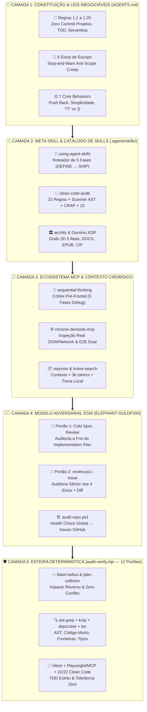
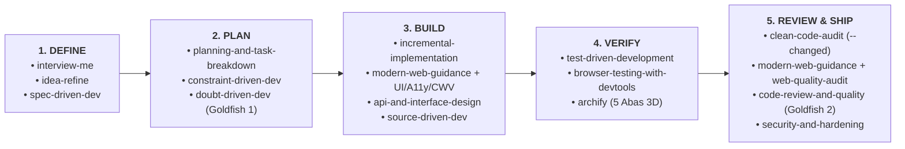
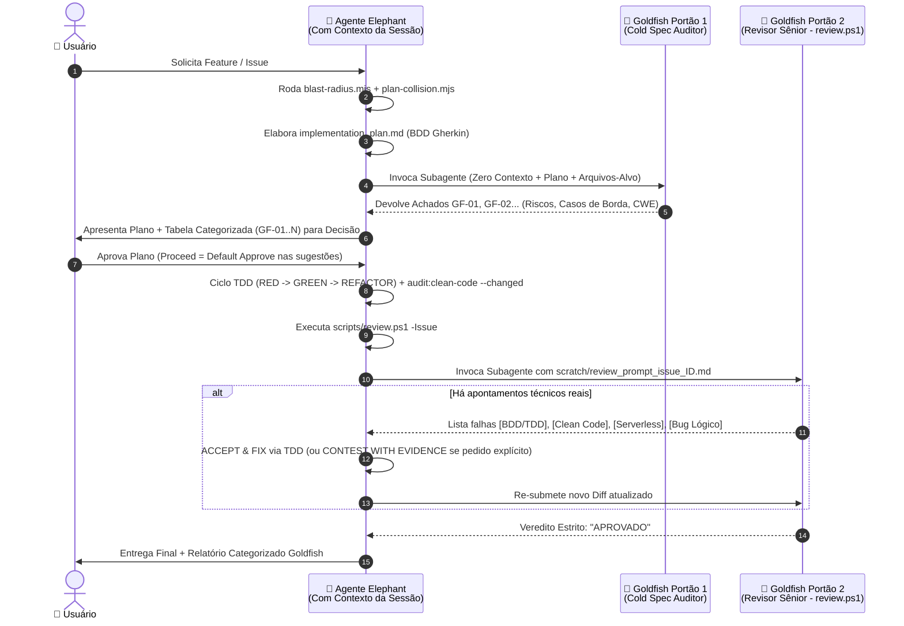

# 🛡️ Apresentação Técnica & Executiva: Engineering Harness para Desenvolvimento Assistido por IA
### *Arquitetura Reutilizável Multi-Projeto de Governança Determinística, Padrão EGM (Elephant-Goldfish), Skills Soberanas, Guardrails AST e Auditoria de 12 Portões*

---

## 🎯 Slide 1: Visão Executiva — O Paradigma do Engineering Harness

> **Tese Central:** Modelos de linguagem (LLMs) sem trilhos produzem velocidade ilusória no Dia 1 e dívida técnica exponencial no Dia 30 (*alucinação de escopo, código morto, testes tautológicos, quebras silenciosas em Serverless e regressões*).  
> **Nossa Resposta:** Construímos um **Engineering Harness Determinístico e Adversarial** que transforma agentes autônomos em engenheiros seniores auditáveis, onde **nenhuma linha de código chega ao repositório sem passar por 12 portões determinísticos e 2 auditorias adversariais sem contexto (EGM Goldfish)**.

### Os 4 Resultados Estratégicos (ROI de Engenharia)
1. **Zero Alucinação & Zero Drift Arquitetural:** Contratos físicos verificados por AST (`ast-grep`), grafo 3D sincronizado (`Archify`) e proibição estrita de compatibilidade zumbi (`Regra 1.12`).
2. **Desenvolvimento Paralelo Seguro (Multi-Agent / Multi-Session):** Radar de colisão em `.git/active-plans.json` (`plan-collision.mjs`), isolamento de artefatos por conversa e *staging* cirúrgico por Issue.
3. **Eliminação do Viés de Autoconfirmação (*Self-Review Bias*):** O agente que escreve o plano ou o código (**🐘 Elephant**) nunca é o único a se julgar — um subagente isolado com zero contexto da conversa (**🐠 Goldfish**) audita tanto o plano quanto o diff final.
4. **Qualidade em Tolerância Zero (22/22 Clean Code + 12 Portões):** O comando `npm run precommit` (`audit:verify`) bloqueia deterministicamente qualquer desvio de tipagem, código órfão, vulnerabilidade ou complexidade ciclomática excessiva (`CRAP < 10`).

---

## 🗺️ Slide 2: Arquitetura Geral do Harness (Visão em 5 Camadas)

---

## 📜 Slide 3: `AGENTS.md` — A Constituição de Governança (Regras 1.1 a 1.20)

O arquivo [AGENTS.md](file:///c:/Users/s023319089/Documents/Projetos/mesa-editorial-heldora/AGENTS.md) não é uma documentação passiva: é o **contrato constitucional carregado no prompt de sistema de todas as sessões**.

| Regra | Nome do Guardrail | O que Proíbe / Obriga na Prática |
| :--- | :--- | :--- |
| **1.1 & 1.1.1** | **Controle de Versão & Staging Cirúrgico** | Proibido `git commit`/`push` sem ordem expressa. Proibido `git add .` ou `git add -A`: exige staging explícito arquivo por arquivo do plano e rastreabilidade `(#ID)` ou `(closes #ID)`. |
| **1.2 & 1.3** | **Zero Código Prematuro, Trade-offs & BDD 1:1** | Proibido codificar sem `implementation_plan.md` aprovado, contendo **Boost Trade-off Matrix (Opção A vs. B)**, cenários **BDD Gherkin (`Dado/Quando/Então`)** espelhados 1:1 com a Issue no GitHub e **Cold Spec Review** (com Pre-Mortem de Produção e Navalha de Occam). |
| **1.4** | **Tríade Documental Pré-Código** | Mudanças arquiteturais ou de negócio exigem atualizar `docs/PRD.md`, `docs/ARCHITECTURE.md` e `docs/DIRETRIZES_EDITORIAIS.md` **antes** do código. |
| **1.5** | **Travas Serverless Cloud Run** | **Anti-Freeze:** Zero promessas *fire-and-forget* pós-resposta HTTP. **Stateless:** Zero estado mutável em memória global do servidor. Uso estrito de `PORT ?? 8080` e `SIGTERM`. |
| **1.6 & 1.16** | **TDD Mandatório & Two-Cycle Workflow** | Ciclo 🔴 RED → 🟢 GREEN → 🔵 REFACTOR para cada fatia vertical. Separação estrita entre **Inner Loop** (testes cirúrgicos do domínio) e **Outer Loop** (`npm run precommit`). |
| **1.11** | **5 Eixos & Gatilho *Stop-and-Warn*** | Classifica demandas nos Eixos **A (Infra)**, **B (Segurança/CWE)**, **C (IA/Domínio)**, **D (UI/Editor)** e **E (Persistência)**. Se cruzar > 2 eixos ou misturar Infra com UI, o agente **PARA** e propõe fatiar em novas Issues. |
| **1.12** | **Proibição de Compatibilidade Zumbi** | Banido manter dual-schema (`novo ?? antigo`) ou normalizadores de legado. Mudou contrato? Atualiza 100% da base e bloqueia o formato antigo no `ast-grep`. |
| **1.14 & 1.15** | **Governança de Testes & Paridade Dual E2E** | Proibido nomear testes com `issue-XX` ou `stage-a-cluster`. Organização estrita em 6 domínios (`ai`, `editor`, `kdp`, `telemetry`, `storage`, `governance`) + Paridade 1:1 entre Playwright (`.spec.ts`) e MCP (`.mcp.ts`). |
| **1.19 & 1.20** | **Léxico Canônico & Modern Web Guidance** | Adoção estrita de **"Bíblia da Obra"** (banido *"Bíblia de Lore"*) e consulta obrigatória a `modern-web-guidance` com `legacy-scan = 0` em `frontend` e `landing` (`structuredClone`, `toSorted()`, `!isComposing`, `scrollbar-color`). |

---

## 🧠 Slide 4: Ciclo `/using-agent-skills` — Orquestração por Fase de Engenharia

Em vez de prompts improvisados, cada turno de trabalho aciona o roteador [SKILL.md](file:///c:/Users/s023319089/Documents/Projetos/mesa-editorial-heldora/.agents/skills/using-agent-skills/SKILL.md), ativando procedimentos especializados para cada etapa do ciclo de vida:

### O Padrão *Domain-as-a-Skill* (Encapsulamento de Regras de Negócio)
Em vez de inflar o prompt global ou confiar na memória do LLM para regras complexas de negócio (sejam fiscais, financeiras, jurídicas ou editoriais), o harness isola o conhecimento específico do produto em Skills soberanas sob demanda:
- **Exemplo Real (Caso Heldora — Publicação Amazon KDP):** `kdp-docx-exporter`, `kdp-epub-exporter`, `kdp-copyright-and-cip-cataloging` (blindando fórmulas matemáticas de sangria, margens progressivas, lombada, sumário interativo e catalogação internacional em 26 variantes de idioma).
- **Segurança & Modelagem de Ameaças (Suite Mantis):** `mantis-threat-model`, `mantis-advise`, `mantis-researcher`, `mantis-review`, `mantis-patch` e `firestore-rules-creation` (delegação obrigatória para o subagente especialista `firestore-rules-author`).

---

## 🐘🐠 Slide 5: Padrão EGM (Elephant-Goldfish Model) — Revisão Adversarial em Duplo Portão

### Por que o Modelo Elephant-Goldfish existe?
Um agente de IA que passa 40 turnos conversando com o usuário acumula contexto rico (**🐘 Elephant**), mas desenvolve **viés de autoconfirmação**: ele tende a justificar atalhos e aprovar o próprio código. O **🐠 Goldfish** é um subagente invocado com **zero histórico da conversa**, recebendo apenas os fatos brutos (a especificação, a Issue do GitHub, o Blast Radius e o Diff real).

### Trava de Proteção do Usuário (`ACCEPT & FIX` vs. `CONTEST WITH EVIDENCE`)
- **Bugs técnicos, falta de teste BDD, tipagem ou falha Serverless (`✅ ACCEPT & FIX via TDD`):** O Elephant escreve o teste cobrindo a falha apontada pelo Goldfish, corrige o código e re-submete automaticamente.
- **Sugestão sem contexto que contradiz pedido explícito do usuário (`🛡️ CONTEST WITH EVIDENCE`):** O Elephant **nunca desfaz em silêncio o que o usuário pediu** para agradar o revisor; ele apresenta a evidência do requisito aprovado e preserva a decisão humana.

---

## 🔬 Slide 6: Radiografia do `scripts/review.ps1` e `scripts/audit-repo.ps1`

Temos dois scripts PowerShell complementares que automatizam a coleta de contexto factual para revisão sênior:

### 1. Revisão Cirúrgica por Issue: [review.ps1](file:///c:/Users/s023319089/Documents/Projetos/mesa-editorial-heldora/scripts/review.ps1) (`powershell -File .\scripts\review.ps1 -Issue <ID> -Files "..."`)
1. **Extração Direta da Issue (`gh issue view`):** Puxa os requisitos oficiais e extrai automaticamente via Regex todas as cláusulas **BDD Gherkin (`Cenário / Dado / Quando / Então / E`)**.
2. **Blindagem Anti-Alucinação de Escopo (`gh issue list --state open`):** Injeta a lista de outras issues abertas do roadmap proibindo terminantemente o revisor de cobrar itens que pertencem a outras issues futuras.
3. **Diff com Contexto Completo de Função (`git diff HEAD --function-context`):** Filtra apenas os arquivos da issue (`-Files`), ignorando lockfiles e artefatos gerados, para que o revisor veja a função inteira e não apenas 3 linhas soltas.
4. **Matriz Inegociável de 4 Eixos:**
   - **Eixo 1 — Rastreabilidade BDD 1:1 & Anti-Mock Oco:** Cada cláusula `Então` tem asserção real? Rejeita testes que só testam o próprio mock.
   - **Eixo 2 — Zero Spec Drift & Regra 1.12:** Nomes exatos da especificação e zero dual-schema (`novo ?? antigo`).
   - **Eixo 3 — Segurança Serverless & Tipagem:** Zero promessas sem `await`, zero estado global mutável, uso de `??` em vez de `||`.
   - **Eixo 4 — Simulação de Execucao Mental:** Simula linha a linha em busca de *race conditions*, loops infinitos ou *null/undefined crashes*.

### 2. Auditoria Estrutural do Monorepo: [audit-repo.ps1](file:///c:/Users/s023319089/Documents/Projetos/mesa-editorial-heldora/scripts/audit-repo.ps1)
- Executa um *health check* global combinando árvore do Git, `docs/ARCHITECTURE.md`, `dependency-cruiser`, `tsc`, `ast-grep` e `knip`.
- **Regra de Rastreabilidade:** Desvios estruturais encontrados por `audit-repo.ps1` **nunca são remendados no escuro** — eles geram propostas formais de novas Issues atômicas (`gh issue create`) separadas pelos 5 Eixos.

---

## 🧹 Slide 7: Skill `clean-code-audit` — 22 Regras em Tolerância Zero

A skill [SKILL.md](file:///c:/Users/s023319089/Documents/Projetos/mesa-editorial-heldora/.agents/skills/clean-code-audit/SKILL.md) e seu motor determinístico `scan-clean-code.mjs` auditam o código tanto de forma incremental antes do review (`--changed`) quanto em modo de bloqueio total no precommit (`--enforce-zero-rules`).

### As 22 Regras Agrupadas por Dimensão
- **Estrutura, Coesão & Complexidade (`R1`, `R2`, `R6`, `R7`, `R9`, `R21`, `R22`):**
  - `R1`: Funções pequenas (4–25 linhas imperativas efetivas, descontando JSX declarativo e templates multilinhas).
  - `R2`: Single Responsibility Principle (proibido misturar I/O de servidor com UI/JSX ou importar SDKs de I/O em módulos de contratos).
  - `R6`: DRY (zero blocos duplicados de 6+ linhas significativas).
  - `R9`: Aninhamento raso ($< 3$ níveis com *guard clauses*) e **Índice CRAP < 10**:
    $$\text{CRAP}(m) = \text{comp}(m)^2 \times (1 - \text{cov}(m))^3 + \text{comp}(m) < 10$$
  - `R21` & `R22`: Zero dependências circulares (`A ↔ B`) e zero ternários aninhados.
- **Tipagem, Fronteiras & Dados (`R5`, `R15`, `R16`, `R18`, `R20`):**
  - `R5`: Zero `any` e **Estados Ilegais Irrepresentáveis** (proibido combinar $\ge 3$ flags booleanas como `isLoading`, `isSuccess`, `isError`; obrigatório usar *Discriminated Unions* `status: 'idle' | 'loading' | 'success' | 'error'`).
  - `R15` & `R16`: Máximo de 3 parâmetros posicionais (usar objeto de opções) e imutabilidade estrita de argumentos.
  - `R18` & `R20`: Zero compatibilidade zumbi (`a.word_count ?? a.wordCount`) e *Parse, Don't Validate* (proibido `JSON.parse(x) as Tipo` sem schema/TypeGuard).
- **Resiliência Serverless Cloud Run & Observabilidade (`R10`, `R12`, `R13`, `R17`, `R19`):**
  - `R17`: **Anti-Freeze Serverless** (toda Promise aguardada com `await` antes do retorno HTTP; zero `setTimeout` solto no backend).
  - `R19`: **Servidor 100% Stateless** (zero `new Map()` ou estado mutável em escopo global de módulo).
  - `R10`, `R12`, `R13`: Erros com contexto (`received`/`expected`), logs JSON estruturados e zero *silent catch* (`catch {}` vazio ou perda do `{ cause: err }`).
- **Legibilidade, Semântica & Testes Comportamentais (`R3`, `R4`, `R8`, `R11`, `R14`):**
  - `R3`, `R4`, `R11`, `R14`: Nomes com intenção (banido `data`, `temp`, `val`), docstrings com proveniência, zero comentários óbvios e constantes nomeadas com unidade (`MAX_RETRY_DELAY_MS`).
  - `R8`: **Injeção de Dependência (DI) & Testes Comportamentais** (proibido instanciar `new Firestore()` hardcoded e proibidos testes teatrais `expect(true).toBe(true)`).

---

## 🛡️ Slide 8: `audit-verify.mjs` (`npm run precommit`) — Os 12 Portões Determinísticos

Antes que qualquer tarefa possa ser considerada concluída (Outer Loop da Regra 1.16), o script [audit-verify.mjs](file:///c:/Users/s023319089/Documents/Projetos/mesa-editorial-heldora/scripts/audit-verify.mjs) executa em sequência **12 verificações determinísticas**. Se qualquer passo retornar código $\neq 0$, a entrega é bloqueada imediatamente:

| Passo | Portão Determinístico | Ferramenta / Script | O que Bloqueia |
| :---: | :--- | :--- | :--- |
| **1** | **Integridade do Lockfile** | `check-lockfile-sync.mjs` | Descompasso entre `package-lock.json` e os workspaces `frontend`, `backend` e `landing` (evita quebra de `npm ci`). |
| **2** | **Segurança de Supply Chain** | `npm audit --omit=dev` | Vulnerabilidades `high` ou `critical` em dependências de produção. |
| **3** | **Guardrails Sintáticos AST** | `ast-grep` (`npm run ast:scan`) | Uso proibido de `process.env.X || default`, padrões legados banidos e anti-patterns sintáticos. |
| **4** | **Fronteiras Arquiteturais** | `dependency-cruiser` | Vazamento de módulos de servidor para o cliente, importações cruzadas ilegais e ciclos. |
| **5** | **Código Morto & Órfãos** | `knip` (`audit:dead-code`) | Arquivos abandonados por alucinação, exports nunca consumidos e dependências fantasmas. |
| **6** | **Typecheck Frontend** | `tsc` (`frontend`) | Qualquer erro de contrato estático TypeScript na aplicação Next.js. |
| **7** | **Typecheck Backend** | `tsc` (`backend`) | Qualquer erro de contrato estático TypeScript nos motores de IA e workers. |
| **8** | **Typecheck Landing Page** | `tsc` (`landing`) | Qualquer erro de tipagem na vitrine comercial. |
| **9** | **Fitness Function Arquitetural** | `sync-architecture-graph.mjs --check` | Divergência (Drift) entre rotas/prompts/fluxos E2E reais no disco e o grafo 3D (`Archify`). |
| **10** | **Suíte de Regressão Completa** | `vitest` (`npm test`) | Qualquer falha nas suítes unitárias e de integração (Backend + Frontend). |
| **11** | **Governança Semântica de Testes** | `check-test-naming-governance.mjs` | Testes nomeados com `issue-XX`, `pr-XX`, `cluster` ou fora dos 6 diretórios canônicos de domínio. |
| **12** | **Tolerância Zero Clean Code** | `scan-clean-code.mjs --enforce-zero-rules` | Qualquer violação em qualquer uma das **22 regras** de Clean Code em todo o repositório. |

---

## 💥 Slide 9: Prevenção Pré-Voo — `blast-radius.mjs` e `plan-collision.mjs`

O harness não age apenas no final (*post-mortem*); ele protege o planejamento **antes da primeira linha de código ser escrita**:

### 1. Análise de Impacto Reverso: [blast-radius.mjs](file:///c:/Users/s023319089/Documents/Projetos/mesa-editorial-heldora/scripts/blast-radius.mjs)
- **Como funciona:** Constrói o grafo de importações diretas, re-exports (`export * from`) e referências de prompts em todo o monorepo.
- **Classificação Automática:** Identifica a Camada Arquitetural (`CLIENTS`, `CORE`, `SERVICES`, `PERSISTENCE`, `PUBLICATION`), o **Eixo de Governança (A a E)**, o nível de risco (`LOW`, `MEDIUM`, `HIGH` quando $\ge 5$ consumidores) e lista exatamente **quais suítes Vitest precisam ser rodadas no Inner Loop**.

### 2. Radar de Colisão Paralela: [plan-collision.mjs](file:///c:/Users/s023319089/Documents/Projetos/mesa-editorial-heldora/scripts/plan-collision.mjs)
- **Problema resolvido:** Duas conversas ou agentes trabalhando em Issues diferentes ao mesmo tempo na mesma máquina e editando o mesmo arquivo sem saber.
- **Solução:** Ao criar um plano, o agente registra os arquivos-alvo em `.git/active-plans.json` (fora do working tree do Git):
  `node scripts/plan-collision.mjs register --issue 50 --files frontend/src/a.ts`
- **Resultado:** O plano exibe no topo `🟢 ZERO COLISÃO PARALELA` ou `⚠️ ALERTA DE COLISÃO PARALELA` apontando exatamente qual outra Issue ativa reservou aquele arquivo. Após o commit cirúrgico, `release --issue 50` libera os arquivos.

---

## 🔌 Slide 10: Ecossistema MCP, `Archify` 3D e Governança Dual de Testes

### 1. Servidores MCP Locais de Baixa Latência (`stdio`) e Pesquisa com Trava
- **`sequential-thinking` (Córtex Pré-Frontal):** Obrigatório em algoritmos de Diff, fluxos Serverless Cloud Run, segurança CWE e arquivos com Blast Radius `HIGH`. Segue o protocolo de 5 fases (*Isolamento do Sintoma → Hipóteses Concorrentes → Coleta Factual sem editar código → Blast Radius → Convergência BDD*).
- **`chrome-devtools-mcp` (Runtime Real):** Inspeção ao vivo de DOM, console, rede, acessibilidade WCAG e validação visual em Light e Dark mode.
- **`brave-search` + Trava Obrigatória de Confrontação:** Toda busca externa é confrontada com as skills soberanas locais (`.agents/skills/`). Se a web divergir da nossa regra local, **a execução para e o usuário decide**.
- **`repomix` (`npm run context:summary`):** Condensação cirúrgica de assinaturas e tipos via Tree-sitter em $< 3.000$ tokens para planejamento macro.

### 2. Arquitetura Viva em 5 Abas (`Archify` — [mesa-editorial-architecture-3d.html](file:///c:/Users/s023319089/Documents/Projetos/mesa-editorial-heldora/docs/architecture/mesa-editorial-architecture-3d.html))
Gerado e verificado automaticamente por `sync-architecture-graph.mjs`:
1. **🌐 Topologia 3D:** Esfera orbital interativa das 5 camadas com partículas de Blast Radius.
2. **⚡ Pipelines & Sequência IA:** Linha do tempo das Fases 1 a 4, prompts físicos (`_common.md`) e Context Caching.
3. **💰 Telemetria & Créditos:** Fluxo financeiro e gravação tripla (`Obra`, `Autora` e `Sistema` nas 4 caixas mensais).
4. **🔄 Máquinas de Estado:** Transições formais de ciclo de vida de Projetos, Seções e Lotes.
5. **🧪 Jornadas E2E:** Passos extraídos diretamente dos adaptadores `.mcp.ts`.

### 3. Pirâmide de Testes & Paridade Dual E2E (Regra 1.14 e 1.15)
- **Unitários & Integração (Vitest):** Nascidos via TDD estrito a partir de cláusulas BDD Gherkin, organizados semanticamente em 6 domínios (`ai`, `editor`, `kdp`, `telemetry`, `storage`, `governance`) e protegidos contra nomes de issues por `check-test-naming-governance.mjs`.
- **Paridade Dual E2E 1:1:** Cada jornada crítica possui simultaneamente o teste headless para CI (`frontend/e2e/*.spec.ts` via Playwright) e o cenário declarativo para agentes autônomos (`frontend/e2e/mcp/*.mcp.ts` via Chrome DevTools MCP), compartilhando as mesmas rotas e seletores `data-testid`.
