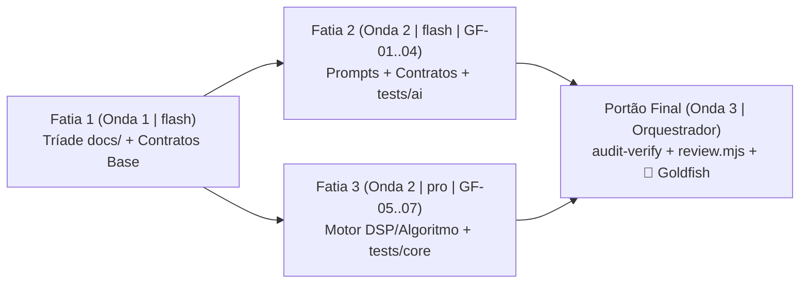

# 🕸️ Orquestração Reativa por Grafo de Dependências entre Fatias (`dag-slice-orchestrator`)

Esta skill soberana codifica o protocolo **Modo 2 Refinado (DAG Wave Execution)** sem alterar nenhuma skill de repositórios externos (`planning-and-task-breakdown`, `incremental-implementation`, `test-driven-development`). Quando o `node scripts/blast-radius.mjs <arquivos> --json` retornar `ceremonyTier: "FULL_EGM_DAG"` com mais de uma fatia vertical, o agente principal da conversa (**🐘 Elephant / Orquestrador**) constrói um Grafo Acíclico Dirigido (DAG) no final do `implementation_plan.md` e despacha subagentes restritos (`slice-executor`) protegidos pelo **Hard Sandbox criptográfico (`plan-collision.mjs snapshot-slice / verify-slice`)**.

---

## 🎯 1. Ordem Cronológica na Fase `PLAN` (Estritamente APÓS o 1º Portão 🐠 Goldfish) e Estrutura do Grafo DAG

> **REGRA DE OURO DE SEQUENCIAMENTO E ALOCAÇÃO DE ACHADOS GOLDFISH NAS SLICES (`Post-Goldfish DAG & Slice Allocation`):**
> O **🐘 Elephant NUNCA deve fechar o Grafo DAG antes da análise do 1º Portão 🐠 Goldfish (`Cold Spec Review`)**, e **NENHUM achado aprovado `GF-01..N` pode ficar solto fora de uma fatia (`Slice`)**. A ordem obrigatória dentro da fase `PLAN` é:
> 1. Elaborar o rascunho de `implementation_plan.md` (Objetivo, Blast Radius, Fatias preliminares, Boost Trade-off Matrix e Cenários BDD Gherkin);
> 2. Executar o **1º Portão 🐠 Goldfish (`Cold Spec Review`)** e consolidar a tabela `## 🐠 Relatório Cold Spec Review (EGM Goldfish)` (`GF-01..N`);
> 3. **Alocar 100% dos achados `GF-01..N` dentro das Fatias (`Slices`):**
>    - Se um achado `GF-XX` recair sobre os arquivos de uma fatia existente, incorpore-o na descrição daquela fatia e vincule o ID `GF-XX` na coluna **`GF-IDs Vinculados`** da tabela do Grafo DAG;
>    - Se um achado `GF-XX` tocar arquivos novos ou um contrato base compartilhado por duas fatias paralelas, **crie uma Slice dedicada no Grafo DAG** (ex.: `Fatia Base Contratos GF` na `Onda 1`, ou uma nova `Fatia N`) para que todo `GF-XX` tenha um único subagente dono e `Allowed Files Whitelist` 100% disjunta;
> 4. **Construir/consolidar ao final do `implementation_plan.md` a seção `## 🕸️ Grafo de Dependências entre Fatias (DAG Execution Plan)`**, exibindo para cada fatia os seus `GF-IDs Vinculados`, `Model`, `Allowed Files Whitelist` e comando de teste;
> 5. Sincronizar o plano final 1:1 com a Issue no GitHub (`gh issue edit <ID>`, quando aplicável) e apresentar ao usuário para aprovação (*Proceed*).

Todo `implementation_plan.md` com mais de uma fatia vertical DEVE conter ao final (após a tabela do Cold Spec Review) a seção **`## 🕸️ Grafo de Dependências entre Fatias (DAG Execution Plan)`** com:
1. Um diagrama `mermaid` (`flowchart LR` ou `flowchart TD`) mostrando as ondas de execução e o nó convergente do Portão Final (`audit-verify` + `review.mjs` + **🐠 Goldfish**);
2. A **Tabela de Despacho e Isolamento por Fatia** especificando explicitamente:
   - `Fatia` (`Fatia 1`, `Fatia 2`, ...);
   - `Onda` (`Onda 1`, `Onda 2`, ...);
   - `depends_on` (quais fatias precisam estar `[x]` antes de disparar esta);
   - `GF-IDs Vinculados` (quais itens `GF-01..N` do Cold Spec Review são de responsabilidade obrigatória desta fatia — **100% dos `GF-XX` aprovados devem estar alocados em alguma fatia**);
   - `Model Tier` (`"flash"` | `"inherit"` | `"pro"`);
   - `Allowed Files Whitelist` (lista fechada e exclusiva de arquivos de produção e teste que a fatia pode tocar);
   - `Inner Loop Verify Command` (comando cirúrgico de teste + linter da fatia).

### Exemplo de Seção no `implementation_plan.md`

```markdown
## 🕸️ Grafo de Dependências entre Fatias (DAG Execution Plan)



| Fatia | Onda | `depends_on` | `GF-IDs Vinculados` | `Model` | `Allowed Files Whitelist` (Escopo Fechado) | Comando de Verificação (`Inner Loop`) |
| :--- | :---: | :---: | :---: | :---: | :--- | :--- |
| **Fatia 1** | `Onda 1` | `[]` | `—` | `"flash"` | `docs/PRD.md`, `docs/ARCHITECTURE.md`, `docs/DIRETRIZES_DOMINIO.md` | Validação de links e Gate 3 |
| **Fatia 2** | `Onda 2` | `[Fatia 1]` | `GF-01, GF-02, GF-03, GF-04` | `"flash"` | `app/prompts/*.md`, `app/schemas.py`, `tests/ai/*` | `pytest tests/ai/test_contracts.py` |
| **Fatia 3** | `Onda 2` | `[Fatia 1]` | `GF-05, GF-06, GF-07` | `"pro"` | `services/worker/processor.py`, `tests/core/test_worker.py` | `pytest tests/core/test_worker.py` |
```

---

## 🧠 2. Matriz de Equivalência Multi-Host de Modelos e Subagentes (`flash / haiku / codex-mini`, `inherit / sonnet / codex-default`, `pro / opus / o3-pro`)

O **🐘 Elephant** seleciona o Tier de modelo e o mecanismo de subagente segundo a complexidade cognitiva, o risco e o host agêntico em execução:

| Tier | **Google Antigravity** (`invoke_subagent`) | **Anthropic Claude Code** (`.claude/agents/slice-executor.md`) | **OpenAI Codex CLI** (`codex exec`) | Quando o 🐘 Elephant DEVE atribuir este Tier |
| :--- | :---: | :---: | :---: | :--- |
| **🟢 Tier 1 — Rápido (Daily Driver)** | `Model: "flash"` (**Hydrogen** `gemini-4-hydrogen`) | `model: haiku` (`Task` / `Agent` tool) | `codex exec -m codex-mini --full-auto` | Fatias `XS` / `S` com `Blast Radius: LOW`: atualização da Tríade `docs/`, templates `.md`, configurações, constantes, schemas lineares e testes de contrato direto onde o `implementation_plan.md` já entregou a especificação mastigada. |
| **🔵 Tier 2 — Eficiente (Interactive Pro)** | `Model: "inherit"` (**Parent** `Argon` / `Neon`) | `model: sonnet` (`Task` / `Agent` tool) | `codex exec -m codex-default --full-auto` | Fatias `M` com `Blast Radius: MEDIUM`: lógica de domínio padrão, rotas de API, integrações de banco de dados / Object Storage e suítes de testes com mocks moderados, mantendo o mesmo consumo enxuto da sessão principal. |
| **🟣 Tier 3 — Frontier Superior & Security** | `Model: "pro"` (**Carbon** `gemini-4-carbon`) | `model: opus` (`Task` / `Agent` tool) | `codex exec -m o3-pro --full-auto` | 1. **Cirurgia de Alta Complexidade e Segurança (`Blast Radius: HIGH`, Algoritmo Pesado ou Security Auditing):** Fatias envolvendo matemática de sinais/DSP, grafos complexos, concorrência assíncrona crítica, remediações de segurança/CWE (`mantis-advise`) ou refatorações estruturais;<br/>2. **Escalonamento Automático em Falha (*Retry Escalation*):** Sempre que um subagente Tier 1 (`flash`/`haiku`/`codex-mini`) ou Tier 2 (`inherit`/`sonnet`/`codex-default`) falhar **2 vezes seguidas** no teste da fatia ou no `scan-clean-code.mjs`, o Orquestrador escala a fatia para Tier 3 (`pro`/`opus`/`o3-pro`). |

---

## 🔒 3. Fase 3 (`BUILD`): As 5 Travas Determinísticas Anti-Drift + Protocolo Obrigatório de Hard Sandbox (`plan-collision.mjs`)

Para impedir que subagentes rodando em paralelo no mesmo workspace sofram *Spec Drift* ou atropelem arquivos uns dos outros, o **🐘 Elephant** DEVE aplicar obrigatoriamente estas 5 travas:

### Trava 1 — Ancoragem Direta na Fonte Única de Verdade e nos `GF-IDs Vinculados` (Zero Telefone Sem Fio)
O subagente nunca recebe apenas um resumo livre. O prompt passado ao subagente obriga-o a ler no Passo 0:
1. O caminho absoluto do `implementation_plan.md` aprovado, implementando a sua **Fatia `N`** + obrigatoriamente todos os itens listados em **`GF-IDs Vinculados`** daquela fatia;
2. Os arquivos reais da sua `Allowed Files Whitelist`.

### Trava 2 — Conjuntos de Arquivos 100% Disjuntos na Mesma Onda (`Disjoint File Sets`)
- **Lei Matemática da Onda Paralela:** Duas fatias `Fatia A` e `Fatia B` só podem rodar simultaneamente na mesma `Onda N` se a interseção de suas `Allowed Files Whitelist` (produção + testes) for **estritamente vazia**:
  $$\text{Files}(\text{Fatia } A) \cap \text{Files}(\text{Fatia } B) = \emptyset$$
- Se duas fatias (ou um achado `GF-XX` do Goldfish) precisarem tocar um mesmo arquivo compartilhado (ex.: `app/schemas.py` ou `src/types.ts`), o **🐘 Elephant** DEVE colocar a alteração do contrato compartilhado em uma Slice de onda anterior (`Onda 1`) e declarar `depends_on: [Fatia 1]` nas fatias consumidoras (`Onda 2`).

### Trava 3 — Definição do Subagente Restrito `slice-executor`
No início da fase `BUILD`, antes de disparar a Onda 1:
- **No Antigravity:** chamar `define_subagent` uma única vez (`Name: "slice-executor"`, `EnableWriteTools: true`, `EnableSubagentTools: false`, `EnableMCPTools: true`);
- **No Claude Code:** utilizar o subagente nativo `.claude/agents/slice-executor.md` instalado pelo `init-harness.mjs`;
- **No OpenAI Codex CLI:** utilizar `codex exec --full-auto` passando a `Allowed Files Whitelist` explícita.

### Trava 4 — Hard Sandbox Criptográfico de Whitelist (`plan-collision.mjs snapshot-slice / verify-slice`) + *Retry Escalation*
A obediência à `Allowed Files Whitelist` **NÃO depende apenas de prompt**: ela é fiscalizada fisicamente via hash `SHA-256` e backup base64 em `.git/active-plans.json` (`GF-01`):

1. **Antes de despachar cada fatia (Snapshot Pré-Execução):**
   O **🐘 Elephant** registra o snapshot baseline da fatia:
   ```bash
   node scripts/plan-collision.mjs snapshot-slice --slice <ID> --files "<arq1>,<arq2>,..."
   ```
2. **Imediatamente após o retorno do subagente (Verificação e Reversão Cirúrgica Pós-Execução):**
   O **🐘 Elephant** executa a verificação física com reversão automática de arquivos intrusos (protegendo a união de `allowedFiles` das demais fatias paralelas ativas e restaurando os bytes exatos de arquivos pré-existentes da Onda 1 sem perda de dados):
   ```bash
   node scripts/plan-collision.mjs verify-slice --slice <ID> --revert-unauthorized
   ```
3. **Execução do Comando de Teste Cirúrgico e *Retry Escalation*:**
   - Em seguida, o Orquestrador roda o comando de teste exclusivo da fatia + `node scripts/scan-clean-code.mjs <arquivos_da_fatia>`.
   - Na 1ª falha: o Orquestrador reenvia mensagem ao subagente apontando o erro exato;
   - Se falhar pela 2ª vez: o Orquestrador aplica **Escalonamento de Tier (*Retry Escalation*)**, despachando um subagente Tier 3 (`"pro"` / `opus` / `o3-pro`) para concluir a fatia.
4. Somente após `verify-slice` retornar `ok: true` e o teste da fatia passar com código `0`, o Orquestrador marca `[x]` na fatia e dispara imediatamente as fatias da próxima onda cujos `depends_on` foram 100% satisfeitos.

### Trava 5 — Convergência Obrigatória no Portão Final do Orquestrador (`audit-verify` + `review.mjs` + 2º Portão 🐠 Goldfish)
Nenhum `slice-executor` encerra a entrega. Quando todas as ondas do grafo DAG estiverem `[x]`:
1. O **🐘 Elephant** executa no processo principal a auditoria determinística completa (`node scripts/audit-verify.mjs`);
2. Executa `node scripts/review.mjs --issue <ID> --files "<todos_arquivos>"` (ou `--plan <caminho_plano> --files "<todos_arquivos>"`) e invoca o subagente **🐠 Goldfish de Implementação** lendo `scratch/review_prompt.md` até obter o veredito **`APROVADO`**;
3. Realiza o commit cirúrgico (quando autorizado pelo usuário) listando exclusivamente os arquivos da entrega e libera o `plan-collision`.
