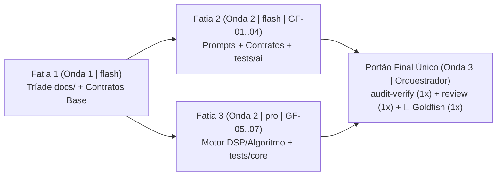

# 🕸️ Orquestração Reativa por Grafo de Dependências entre Fatias (`dag-slice-orchestrator` — `Single-Execution Gate Protocol`)

Esta skill soberana codifica o protocolo **Modo 2 Refinado (DAG Wave Execution)** com o **`Single-Execution Gate Protocol`** (eliminando a multiplicação quadrática de portões e tokens por fatia) sem alterar nenhuma skill de repositórios externos (`planning-and-task-breakdown`, `incremental-implementation`, `test-driven-development`).

No pré-voo da fase **`PLAN` (1 única vez antes de montar o plano)**, o Orquestrador (**🐘 Elephant**) calcula o tier de cerimônia executando:
- **Node.js / TypeScript (`aegis-harness`, `mesa-editorial-heldora`):** `node scripts/blast-radius.mjs <arquivos> --json` (campo `ceremonyTier`)
- **Python (`awencanto`):** `python scripts/blast-radius.py <arquivo> --json` (campo `ceremony_tier`)

### 🚦 Limiar de Cerimônia e Limiar de Ativação de Subagentes (`DAG Spawn Threshold`)
1. **Obrigatoriedade Universal do Duplo Portão 🐠 Goldfish (`goldfishRequired: true`):** Todo `implementation_plan.md` exige o **1º Portão 🐠 Goldfish** na Fase `PLAN` (gravando o rascunho com `RequestFeedback: false` e só habilitando `RequestFeedback: true` após consolidar `GF-01..N` + Grafo DAG) e o **2º Portão 🐠 Goldfish** na Fase `REVIEW`.
2. **Execução Sequencial na Sessão Principal (`"XS_EXPRESS"` OU `"FULL_EGM_DAG"` com `<= 4` arquivos de produção sem paralelismo real na mesma onda):** Mantém o **1º e o 2º Portão 🐠 Goldfish**, e o próprio **🐘 Elephant** implementa as fatias diretamente na sessão principal (aproveitando 100% do *Prompt Cache* sem custo de cold start de subagentes `slice-executor`).
3. **`"FULL_EGM_DAG"` com Paralelismo Real na Mesma Onda (`>= 2` fatias independentes na mesma Onda OU `5+` arquivos de código):** O **🐘 Elephant** despacha subagentes `slice-executor` por onda, protegidos pelo **Hard Sandbox criptográfico (`plan-collision.mjs` ou `plan-collision.py` com `snapshot-slice` / `verify-slice --revert-unauthorized`)** e pelo **`Single-Execution Gate Protocol`**.

---

## 🎯 1. Ordem Cronológica na Fase `PLAN` (Estritamente APÓS o 1º Portão 🐠 Goldfish) e Estrutura do Grafo DAG

> **REGRA DE OURO DE SEQUENCIAMENTO E ALOCAÇÃO DE ACHADOS GOLDFISH NAS SLICES (`Post-Goldfish DAG & Slice Allocation`):**
> O **🐘 Elephant NUNCA deve fechar o Grafo DAG antes da análise do 1º Portão 🐠 Goldfish (`Cold Spec Review`)**, e **NENHUM achado aprovado `GF-01..N` pode ficar solto fora de uma fatia (`Slice`)**. A ordem obrigatória dentro da fase `PLAN` é:
> 1. Executar `blast-radius` **1 única vez** para todos os arquivos-alvo e elaborar o rascunho de `implementation_plan.md` (Objetivo, Blast Radius, Fatias preliminares, Boost Trade-off Matrix e Cenários BDD Gherkin);
> 2. Executar o **1º Portão 🐠 Goldfish (`Cold Spec Review`)** e consolidar a tabela `## 🐠 Relatório Cold Spec Review (EGM Goldfish)` (`GF-01..N`);
> 3. **Alocar 100% dos achados `GF-01..N` dentro das Fatias (`Slices`):**
>    - Se um achado `GF-XX` recair sobre os arquivos de uma fatia existente, incorpore-o na descrição daquela fatia e vincule o ID `GF-XX` na coluna **`GF-IDs Vinculados`** da tabela do Grafo DAG;
>    - Se um achado `GF-XX` tocar arquivos novos ou um contrato base compartilhado por duas fatias paralelas, **crie uma Slice dedicada no Grafo DAG** (ex.: `Fatia Base Contratos GF` na `Onda 1`, ou uma nova `Fatia N`) para que todo `GF-XX` tenha um único dono e `Allowed Files Whitelist` 100% disjunta;
> 4. **Construir/consolidar ao final do `implementation_plan.md` a seção `## 🕸️ Grafo de Dependências entre Fatias (DAG Execution Plan)`**, exibindo para cada fatia os seus `GF-IDs Vinculados`, `Model`, `Allowed Files Whitelist` e **1 único arquivo de teste unitário** no `Inner Loop Verify Command` (nunca curingas `*.test.*` nem `audit-verify`);
> 5. Sincronizar o plano final 1:1 com a Issue no GitHub (`gh issue edit <ID>`, quando aplicável) e apresentar ao usuário para aprovação (*Proceed*).

Todo `implementation_plan.md` com mais de uma fatia vertical DEVE conter ao final (após a tabela do Cold Spec Review) a seção **`## 🕸️ Grafo de Dependências entre Fatias (DAG Execution Plan)`** com:
1. Um diagrama `mermaid` (`flowchart LR` ou `flowchart TD`) mostrando as ondas de execução e o nó convergente do Portão Final (`audit-verify` + `review` + **🐠 Goldfish**);
2. A **Tabela de Despacho e Isolamento por Fatia** especificando explicitamente:
   - `Fatia` (`Fatia 1`, `Fatia 2`, ...);
   - `Onda` (`Onda 1`, `Onda 2`, ...);
   - `depends_on` (quais fatias precisam estar `[x]` antes de disparar esta);
   - `GF-IDs Vinculados` (**100% dos `GF-XX` aprovados devem estar alocados em alguma fatia**);
   - `Model Tier` (`"flash"` | `"inherit"` | `"pro"`);
   - `Allowed Files Whitelist` (lista fechada e exclusiva de arquivos de produção e teste que a fatia pode tocar);
   - `Inner Loop Unit Test Command` (exclusivamente o 1 arquivo de teste unitário da própria fatia — **proibido** usar `audit-verify`, `precommit` ou `*.test.*` dentro da fatia).

### Exemplo de Seção no `implementation_plan.md`

```markdown
## 🕸️ Grafo de Dependências entre Fatias (DAG Execution Plan)



| Fatia | Onda | `depends_on` | `GF-IDs Vinculados` | `Model` | `Allowed Files Whitelist` (Escopo Fechado) | Comando de Teste Unitário (`Micro-Gate`) |
| :--- | :---: | :---: | :---: | :---: | :--- | :--- |
| **Fatia 1** | `Onda 1` | `[]` | `—` | `"flash"` | `docs/PRD.md`, `docs/ARCHITECTURE.md`, `docs/DIRETRIZES_DOMINIO.md` | Validação rápida de links |
| **Fatia 2** | `Onda 2` | `[Fatia 1]` | `GF-01, GF-02, GF-03, GF-04` | `"flash"` | `app/prompts/*.md`, `app/schemas.py`, `tests/ai/test_contracts.py` | `pytest tests/ai/test_contracts.py` |
| **Fatia 3** | `Onda 2` | `[Fatia 1]` | `GF-05, GF-06, GF-07` | `"pro"` | `services/worker/processor.py`, `tests/core/test_worker.py` | `pytest tests/core/test_worker.py` |
```

---

## 🧠 2. Matriz de Equivalência Multi-Host de Modelos e Subagentes (`flash / haiku / codex-mini`, `inherit / sonnet / codex-default`, `pro / opus / o3-pro`)

| Tier | **Google Antigravity** (`invoke_subagent`) | **Anthropic Claude Code** (`.claude/agents/slice-executor.md`) | **OpenAI Codex CLI** (`codex exec`) | Quando o 🐘 Elephant DEVE atribuir este Tier |
| :--- | :---: | :---: | :---: | :--- |
| **🟢 Tier 1 — Rápido (Daily Driver)** | `Model: "flash"` (**Hydrogen** `gemini-4-hydrogen`) | `model: haiku` (`Task` / `Agent` tool) | `codex exec -m codex-mini --full-auto` | Fatias `XS` / `S` com `Blast Radius: LOW`: atualização da Tríade `docs/`, templates `.md`, configurações, constantes, schemas lineares e testes de contrato direto onde o `implementation_plan.md` já entregou a especificação mastigada. |
| **🔵 Tier 2 — Eficiente (Interactive Pro)** | `Model: "inherit"` (**Parent** `Argon` / `Neon`) | `model: sonnet` (`Task` / `Agent` tool) | `codex exec -m codex-default --full-auto` | Fatias `M` com `Blast Radius: MEDIUM`: lógica de domínio padrão, rotas de API, integrações de banco de dados / Object Storage e suítes de testes com mocks moderados, mantendo o mesmo consumo enxuto da sessão principal. |
| **🟣 Tier 3 — Frontier Superior & Security** | `Model: "pro"` (**Carbon** `gemini-4-carbon`) | `model: opus` (`Task` / `Agent` tool) | `codex exec -m o3-pro --full-auto` | 1. **Cirurgia de Alta Complexidade e Segurança (`Blast Radius: HIGH`, Algoritmo Pesado ou Security Auditing):** Fatias envolvendo matemática de sinais/DSP, grafos complexos, concorrência assíncrona crítica, remediações de segurança/CWE (`mantis-advise`) ou refatorações estruturais;<br/>2. **Escalonamento Automático em Falha (*Retry Escalation*):** Sempre que um subagente Tier 1 ou Tier 2 falhar **2 vezes seguidas** no teste da fatia, o Orquestrador escala a fatia para Tier 3 (`pro`/`opus`/`o3-pro`). |

---

## 🔒 3. Fase 3 (`BUILD`): As 5 Travas Determinísticas Anti-Drift + Protocolo `Single-Execution Gate`

Para impedir explosão de tokens e garantir que cada portão pesado rode **1 única vez por entrega**, o **🐘 Elephant** DEVE aplicar obrigatoriamente estas 5 travas:

### Trava 1 — Ancoragem Direta e Confinamento de Leitura (Zero Leitura de `AGENTS.md` ou Outras Fatias)
O prompt enviado ao `slice-executor` deve conter as invariantes técnicas inline e instruí-lo a ler **exclusivamente**:
1. A seção da sua **Fatia `N`** e seus **`GF-IDs Vinculados`** no `implementation_plan.md`;
2. Os arquivos reais da sua `Allowed Files Whitelist`.
- **PROIBIÇÃO EXPLÍCITA DE LEITURA E EXECUÇÃO NA SLICE (`Single-Execution Gate`):** O `slice-executor` é **proibido** de ler `AGENTS.md`, `CLAUDE.md`, `docs/*` ou arquivos de outras fatias, e **proibido** de executar `blast-radius`, `audit-verify` / `npm run precommit`, `scan-clean-code.mjs`, `review.mjs` / `review.ps1` ou curingas `*.test.*`. Ele executa **apenas 1 comando de teste unitário** do seu próprio arquivo.

### Trava 2 — Conjuntos de Arquivos 100% Disjuntos na Mesma Onda (`Disjoint File Sets`)
- **Lei Matemática da Onda Paralela:** Duas fatias `Fatia A` e `Fatia B` só podem rodar simultaneamente na mesma `Onda N` se a interseção de suas `Allowed Files Whitelist` (produção + testes) for **estritamente vazia**:
  $$\text{Files}(\text{Fatia } A) \cap \text{Files}(\text{Fatia } B) = \emptyset$$
- Se duas fatias precisarem tocar um mesmo arquivo compartilhado, o **🐘 Elephant** DEVE colocar a alteração do contrato compartilhado em uma Slice de onda anterior (`Onda 1`) e declarar `depends_on: [Fatia 1]` nas fatias consumidoras (`Onda 2`).

### Trava 3 — Definição Enxuta do Subagente Restrito `slice-executor` (`EnableMCPTools: false` | `GF-05`)
No início da fase `BUILD`, antes de disparar a Onda 1:
- **No Antigravity:** chamar `define_subagent` uma única vez com **`EnableMCPTools: false`** e **`EnableSubagentTools: false`** (`Name: "slice-executor"`, `EnableWriteTools: true`, `EnableSubagentTools: false`, `EnableMCPTools: false`), evitando injetar dezenas de schemas MCP no contexto de cada fatia;
- **No Claude Code:** utilizar o subagente nativo `.claude/agents/slice-executor.md`;
- **No OpenAI Codex CLI:** utilizar `codex exec --full-auto` passando a `Allowed Files Whitelist` explícita.

### Trava 4 — Hard Sandbox Criptográfico de Whitelist (`snapshot-slice` / `verify-slice`) + Recebimento Zero-Reexecução
A obediência à `Allowed Files Whitelist` é fiscalizada fisicamente via hash `SHA-256` e backup base64 em `.git/active-plans.json` (`GF-01`):

1. **Antes de despachar cada fatia (Snapshot Pré-Execução):**
   ```bash
   # Repositórios Node.js / TypeScript (aegis-harness / mesa-editorial-heldora):
   node scripts/plan-collision.mjs snapshot-slice --slice <ID> --files "<arq1>,<arq2>,..."
   # Repositórios Python (awencanto):
   python scripts/plan-collision.py snapshot-slice --slice <ID> --files "<arq1>,<arq2>,..."
   ```
2. **Imediatamente após o retorno do subagente (Verificação Instantânea `~50ms` e Zero Re-execução):**
   ```bash
   # Repositórios Node.js / TypeScript (aegis-harness / mesa-editorial-heldora):
   node scripts/plan-collision.mjs verify-slice --slice <ID> --revert-unauthorized
   # Repositórios Python (awencanto):
   python scripts/plan-collision.py verify-slice --slice <ID> --revert-unauthorized
   ```
3. **Proibição de Re-Execução no Orquestrador entre Ondas (`Single-Execution Gate`):**
   - Se o `slice-executor` já retornou o output verde do teste unitário da sua fatia e `verify-slice` retornou `ok: true`, o **🐘 Elephant NÃO re-executa o teste unitário nem roda `scan-clean-code` / `audit-verify` entre ondas**: marca `[x]` imediatamente e dispara a próxima onda!
   - O Orquestrador só intervém se o `slice-executor` reportar falha (reenviando mensagem na 1ª falha e aplicando *Retry Escalation* para Tier 3 `"pro"` na 2ª falha).

### Trava 5 — Portão Final Consolidado Único do Orquestrador (`1x` por Entrega — Node.js & Python | `GF-02`)
Quando **100% das ondas do grafo DAG estiverem `[x]`**, o **🐘 Elephant** executa **uma única vez** no processo principal:
1. **Esteira Determinística Global do Ecossistema (`1x`):**
   - **Node.js (`mesa-editorial-heldora`):** `npm run precommit` (`npm run audit:verify`) + `npm run audit:clean-code -- --changed`
   - **Node.js (`aegis-harness`):** `node scripts/audit-verify.mjs` (que já inclui o Gate `scan-clean-code.mjs --enforce-zero-rules`)
   - **Python (`awencanto`):** `python scripts/audit-verify.py` (12/12 Portões determinísticos + Pytest)
2. **Extração do Dossiê com Cache de Telemetria (`GF-02`) + 2º Portão 🐠 Goldfish (`1x`):**
   - Executa `node scripts/review.mjs --issue <ID> --files "<todos_arquivos>"` (ou `powershell -File .\scripts\review.ps1 -Issue <ID> -Files "<todos_arquivos>"` / `--plan <caminho_plano>`), que reutiliza `scratch/clean_code_telemetry.json` quando os arquivos não mudaram, e invoca **1 única vez** o subagente **🐠 Goldfish de Implementação** até obter **`APROVADO`**;
3. **Commit Cirúrgico (Quando Ordenado pelo Usuário) e Release:**
   - Executa `node scripts/plan-collision.mjs release --issue <ID>` (Node.js) ou `python scripts/plan-collision.py release --issue <ID>` (Python).
