# 🛠️ Guia Universal do Ecossistema MCP, Guardrails Determinísticos & Raciocínio Sequencial

Este guia estabelece os padrões agnósticos de arquitetura, seleção de ferramentas, guardrails determinísticos e raciocínio estruturado para qualquer agente de IA operando sob o ecossistema de **Model Context Protocol (MCP)** e ferramentas de alta precisão.

---

## 🎯 1. Princípio Fundamental: Anti-Guessing (Tolerância Zero a Tentativa e Erro)

O agente de IA **NUNCA DEVE** tentar resolver problemas por "chutes", remendos reativos ou suposições superficiais. Em qualquer tarefa não trivial:
1. **Pense antes de tocar:** Isole causas de sintomas antes de editar arquivos via `sequential-thinking`.
2. **Use a ferramenta certa na camada certa:** Não use terminal para o que o navegador inspeciona melhor; não use busca web para o que a documentação oficial local resolve; não edite código sem antes coletar evidências estruturadas por AST.
3. **Formalize hipóteses e descarte-as com fatos:** Se uma hipótese for refutada, admita a revisão explicitamente e ramifique para a próxima evidência.
4. **Execução Local de Baixa Latência (Zero-Latency Stdio):** Os MCPs de cognição e runtime visual (`sequential-thinking`, `chrome-devtools-mcp`) executam localmente via processos filhos (`stdio`), garantindo resposta instantânea (0ms de ping de rede) e total resiliência offline.

---

## 🗺️ 2. Taxonomia de Ferramentas por Camada de Engenharia

```mermaid
graph TD
    subgraph "1. Meta-Raciocínio & Cognição (MCPs Locais - stdio)"
        ST["sequential-thinking<br/>(Resolução de Problemas, Hipóteses & Loops de Causa Raiz)"]
    end

    subgraph "2. Interface & Runtime Visual (MCPs Locais)"
        CDT["chrome-devtools-mcp<br/>(Navegador Real, DOM, Console, Network, UI/UX, Light/Dark)"]
        STITCH["StitchMCP<br/>(Prototipação Rápida, Telas & Design Systems)"]
    end

    subgraph "3. Guardrails Determinísticos Locais (devDependencies / CLI)"
        KNIP["knip (npm run audit:dead-code)<br/>(Auditoria de Código Órfão & Dependências Fantasma)"]
        SG["ast-grep (npm run ast:search)<br/>(Parser AST Tree-sitter para Refatorações Cirúrgicas)"]
        BR["blast-radius (npm run blast-radius)<br/>(Análise de Impacto Reverso & Testes Impactados)"]
        REPO["repomix (npm run context:summary)<br/>(Empacotamento Compacto de Assinaturas & Tipos)"]
    end

    subgraph "4. Visualização Factual da Arquitetura (Skill)"
        ARCH["archify<br/>(Diagramas Interativos HTML/SVG Verificáveis contra o Código)"]
    end

    subgraph "5. Persistência & Bancos de Dados"
        FS["google-cloud-firestore<br/>(NoSQL Transacional, Consultas, Índices, Agregações)"]
        GCS["datacloud_gcs_remote<br/>(Buckets, Objetos, Storage & Dumps)"]
    end

    subgraph "6. Conhecimento, Documentação & Pesquisa Externa"
        BS["brave-search (Brave Search MCP)<br/>(Pesquisa Web Oficial com Trava de Confrontação)"]
        DOCS["gemini-api-docs<br/>(SDKs Oficiais, Modelos Generativos & Specs)"]
        GENKIT["genkit-mcp-server<br/>(Fluxos de IA, Traces & Runtimes Genkit)"]
        VSEARCH["vertex-ai-search<br/>(Busca Semântica Corporativa)"]
        GDK["google-developer-knowledge<br/>(Base de Conhecimento Oficial Google)"]
    end

    ST -.->|Audita Antes de Concluir| KNIP
    ST -.->|Varre Estrutura AST| SG
    ST -.->|Calcula Impacto| BR
    ST -.->|Mapeia Topologia| ARCH
    ST -.->|Inspeciona Runtime| CDT
    ST -.->|Consulta sob Demanda| BS
```



---

## 📊 3. Matriz de Decisão: Quando Usar vs. Quando NÃO Usar

| Ferramenta / Servidor | Quando USAR | Quando NÃO Usar |
| :--- | :--- | :--- |
| **`sequential-thinking`** | • Falhas de teste unitário/integração ou quebras em CI/CD.<br/>• Diagnóstico de bugs intermitentes, race conditions ou erros assíncronos.<br/>• Refatoração em múltiplos arquivos ou microsserviços.<br/>• Decisões de trade-off de arquitetura e concorrência.<br/>• Remediações de segurança (CWEs, Auth, Firestore Rules). | • Comandos triviais de uma linha.<br/>• Leitura simples de arquivos de texto.<br/>• Ajustes puramente cosméticos de cópia/formatação. |
| **`repomix`** *(CLI Context)* | • Quando o agente precisa de uma visão panorâmica e compacta de assinaturas e tipos do monorepo em < 3.000 tokens (`--compress`).<br/>• Antes de planejar fatias macro que cruzam fronteiras entre frontend e backend. | • Tarefas pontuais em 1 ou 2 arquivos onde `view_file` e `blast-radius` bastam. |
| **`blast-radius`** *(CLI Guardrail)* | • Antes de alterar qualquer arquivo central (`types`, `export`, `routes`).<br/>• Para identificar imediatamente quem quebra e quais testes revalidar. | • Arquivos isolados de teste (`*.test.ts`) ou documentação markdown. |
| **`brave-search` / `search_web`** | • Validações de documentações externas atualizadas (APIs de terceiros e SDKs recentes).<br/>• Investigação de bugs e erros semânticos raros em bibliotecas externas.<br/>• **Fallback Sem API Key:** Se o `brave-search` MCP não estiver configurado na máquina, o agente utiliza automaticamente a ferramenta nativa `search_web` do Antigravity aplicando a mesma **Trava Obrigatória de Confrontação Local**. | • Consultas sobre o código local do próprio projeto.<br/>• Quando a resposta já estiver contida nas skills soberanas locais (`.agents/skills/`). |
| **`knip`** *(CLI Guardrail)* | • Antes de encerrar qualquer bloco de implementação, PR ou refatoração (`npm run audit:dead-code`).<br/>• Detecção de exports órfãos, arquivos não importados e dependências fantasmas no monorepo. | • Durante a escrita de rascunhos de código antes dos testes. |
| **`ast-grep`** *(CLI Guardrail)* | • Renomeações de propriedades, métodos, interfaces e contratos (`npm run ast:search`).<br/>• Mapeamento de todas as desestruturações de parâmetros e chamadas reais em árvore sintática (AST). | • Buscas textuais genéricas em arquivos de documentação markdown (usa-se ripgrep). |
| **`archify`** *(Skill)* | • Novos microsserviços, alterações em filas assíncronas, rotas de API ou novos estágios de pipeline.<br/>• Criação ou alteração de qualquer suíte de teste E2E, mudanças em máquinas de estado ou regras de telemetria/faturamento.<br/>• Manutenção das 5 abas interativas do visualizador 3D (`Topologia 3D`, `Pipelines & Sequência IA`, `Telemetria & Custos`, `Máquinas de Estado` e `Jornadas E2E`). | • Modificações puramente cosméticas de espaçamento/cor CSS em um componente existente que não alteram fluxo, seletores E2E ou contratos. |
| **`chrome-devtools-mcp`** | • Inspeção interativa em navegador real (DOM, Shadow DOM, CSS).<br/>• Auditoria de logs de console (`list_console_messages`) e rede (`list_network_requests`).<br/>• Captura obrigatória de evidências visuais em Light e Dark mode. | • Testes unitários puros ou código puramente backend.<br/>• Rotas headless de API REST que não possuem HTML/UI. |
| **`google-cloud-firestore`** | • Consulta direta a coleções e documentos para validação de integridade.<br/>• Verificação tripla de QA (banco de dados real). | • Armazenamento de dados cujo sistema de registro soberano pertença a outro banco/serviço. |

---

## 🔍 4. Protocolo de Pesquisa Externa (Brave Search MCP) & Trava Obrigatória de Confrontação

Ao utilizar o servidor **Brave Search MCP (`brave-search`)**:

```
[Necessidade de Pesquisa Externa Identificada]
                     │
                     ▼
┌─────────────────────────────────────────────────────────────┐
│ 1. Execução da Busca via Brave Search MCP                   │
│ • Realizar a consulta técnica com termos exatos de versão.  │
└────────────────────────────┬────────────────────────────────┘
                             │
                             ▼
┌─────────────────────────────────────────────────────────────┐
│ 2. Confrontação Obrigatória com as Skills Locais            │
│ • Comparar a informação obtida com os contratos em:        │
│   .agents/skills/<skill-name>/references/                  │
└────────────────────────────┬────────────────────────────────┘
                             │
              ┌──────────────┴──────────────┐
              ▼                             ▼
       [HOUVE DIVERGÊNCIA?]          [SEM DIVERGÊNCIA]
              │                             │
              ▼                             ▼
┌─────────────────────────────┐   ┌──────────────────────────┐
│ TRAVA DE DIVERGÊNCIA ATIVADA│   │ Prosseguir Normalmente   │
│ • PARAR a execução!         │   │ com a implementação.     │
│ • É TERMINANTEMENTE PROIBIDO│   └──────────────────────────┘
│   adotar a versão da web!   │
│ • Apresentar a divergência  │
│   e PERGUNTAR ao usuário    │
│   qual versão seguir.       │
└─────────────────────────────┘
```

---

## 🧠 5. Protocolo Aprofundado: `sequential-thinking` em Engenharia de Software

### O Papel Cognitivo do `sequential-thinking`
Modelos de linguagem avançados (como o Gemini 3.8 Flash High) possuem velocidade impressionante, mas podem apresentar "ansiedade de resposta" (tentar aplicar patches no código antes de absorver o contexto). 

O `sequential-thinking` funciona como o **córtex pré-frontal do agente**: obriga a estruturar pensamentos encadeados, testar hipóteses, ramificar soluções e validar riscos antes de encostar no código-fonte.

### 5.1 Invocação Formal via MCP Tool
O agente invoca a ferramenta utilizando a chamada lazy:
- **ServerName:** `"sequential-thinking"`
- **ToolName:** `"sequentialthinking"`
- **Parâmetros Tipados:**
  - `thought` *(string, obrigatório)*: O passo de raciocínio atual (análise, hipótese, revisão ou validação).
  - `thoughtNumber` *(integer, obrigatório)*: Número sequencial do pensamento atual (1, 2, 3...).
  - `totalThoughts` *(integer, obrigatório)*: Estimativa total inicial (adaptável dinamicamente para cima ou para baixo).
  - `nextThoughtNeeded` *(boolean, obrigatório)*: `true` enquanto o raciocínio estiver evoluindo; `false` apenas na convergência final.
  - `isRevision` *(boolean, opcional)*: `true` quando a evidência refutar um pensamento anterior.
  - `revisesThought` *(integer, opcional)*: Número do pensamento que está sendo refutado ou revisado.
  - `branchFromThought` *(integer, opcional)*: Ponto de partida para uma ramificação ou caminho alternativo.
  - `branchId` *(string, opcional)*: Identificador da ramificação (ex.: `"abordagem-serverless"`, `"abordagem-client-cache"`).

### 5.2 Gatilhos Mandatórios para Disparo de `sequential-thinking`
O agente **DEVE OBRIGATORIAMENTE** acionar o `sequential-thinking` antes de codificar nos seguintes cenários:
1. **Algoritmos Complexos de Texto & Diff:** Lógicas de Myers Diff, realinhamento de parágrafos, seletores de frases e unificação de formatações.
2. **Arquitetura Serverless & Cloud Run:** Lógicas envolvendo ciclo de vida assíncrono, anti-freeze (proibição de promessas unawaited), scale-to-zero e concorrência multilocatário.
3. **Segurança & Hardening:** Correções de vulnerabilidades (CWEs, regras de acesso Firestore, isolamento de prompts contra injeção e autenticação M2M).
4. **Fatias com Blast Radius Elevado:** Qualquer alteração em arquivos centrais (`types`, `routes`, `compiladores`) com múltiplos dependentes reversos.

### 5.3 O Protocolo de 5 Fases em Loops de Resolução de Bugs (Debugging Loop)
1. **Fase 1 (Isolamento do Sintoma vs. Causa):** Qual é o erro exato reportado? Qual era o comportamento esperado? O que NÃO é a causa?
2. **Fase 2 (Árvore de Hipóteses Concorrentes):** Formular pelo menos 2 causas prováveis distintas (contrato/tipagem vs. concorrência/race condition vs. cache/build).
3. **Fase 3 (Coleta Factual de Evidências):** Utilizar ferramentas de leitura/inspeção (`ast-grep`, `view_file`, `blast-radius`). PROIBIDO alterar código nesta fase! Se a evidência refutar a hipótese, usar `isRevision: true`.
4. **Fase 4 (Análise de Blast Radius & Regressão):** Quem consome o módulo a ser alterado? Quais testes existentes cobrem essa área?
5. **Fase 5 (Convergência BDD & Solução Cirúrgica):** Formular a especificação BDD (`Dado... Quando... Então...`) do comportamento esperado, escrever o teste Vitest e definir `nextThoughtNeeded: false`.

---

## 📦 6. Empacotamento de Contexto & Gestão de Memória com `Repomix`

O **Repomix** atua como o condensador cirúrgico de contexto do monorepo, permitindo que o agente extraia todo o esqueleto de tipos, contratos e interfaces em formato XML compacto (< 3.000 tokens):
- **Comando Compacto:** `npm run context:summary` (gera `workspace/context/repomix-output.xml` com Tree-sitter `--compress`).
- **Gestão Autônoma do Agente:** O agente gerencia quando rodar o Repomix. Ele NÃO deve rodá-lo a cada turno; deve acioná-lo sob demanda ao iniciar fatias macro, refatorações cross-module ou ao integrar novos domínios.

---

## 🛡️ 7. Checklist de Exit Gate (Antes de Entregar a Tarefa)

Antes de declarar qualquer funcionalidade, refatoração ou correção de bug concluída:
- [ ] **Análise Pré-Voo (`blast-radius`):** O impacto reverso e testes associados foram mapeados via `npm run blast-radius`?
- [ ] **Raciocínio Registrado:** Decisões complexas foram amadurecidas via `sequential-thinking`?
- [ ] **Requisitos em BDD:** O comportamento esperado foi modelado em formato `Dado / Quando / Então`?
- [ ] **Ciclo TDD Respeitado:** O teste foi escrito primeiro (Red), passou com código mínimo (Green) e foi refatorado?
- [ ] **Mini-Auditoria Determinística (`audit:verify`):** `npm run audit:verify` foi executado com aprovação total nos 6 eixos (ast-grep, knip, tsc frontend, tsc backend, arch:check, vitest)?
- [ ] **Inspeção de Runtime:** Se houver interface visual, foi validada em navegador real via `chrome-devtools-mcp` nos modos Light e Dark?
- [ ] **Topologia Arquitetural (`archify`):** O grafo factual e o visualizador 3D em `docs/architecture/` permanecem sem drift?
