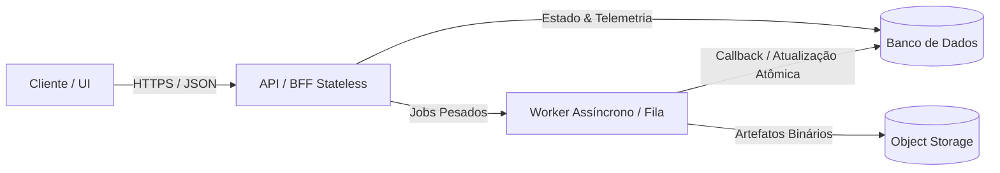

# 🏛️ Arquitetura Técnica & Contratos Imutáveis — {{PROJECT_NAME}}

> **Status:** Documento Constitucional Ativo (`Regra 1.4` e `Regra 1.15` do `AGENTS.md`)
> **Stack Detectada:** `{{STACK_SUMMARY}}` (`{{LANGUAGE}}`)
> **Escopo:** Fonte única de verdade para topologia de serviços, contratos de API, separação de persistência, máquinas de estado e limites de execução em produção.

---

## 1. Decisões Arquiteturais Imutáveis & Stack Oficial
- **Linguagem & Runtime:** `{{LANGUAGE}}` (`{{STACK_SUMMARY}}`).
- **Hospedagem & Computação:** Serverless / Containers Stateless (`0.0.0.0`, porta via `PORT ?? 8080`, Scale-to-Zero, tratamento obrigatório de `SIGTERM` e proibição de processamento fire-and-forget pós-resposta HTTP).
- **Fronteiras de Módulos:** Isolamento estrito entre camadas de Interface/API, Domínio/Serviços e Infraestrutura/Persistência (auditado por `dependency-cruiser` / `blast-radius`).

---

## 2. Topologia de Persistência & Estado (Stateless Server)
1. **Banco de Dados Estruturado (Estado, Catálogos & Telemetria):**
   - Armazena máquinas de estado transacionais, metadados de domínio e telemetria segregada nos 3 níveis (`system/telemetry`, `users/{user_id}`, `resource/{id}`) com 4 visões financeiras (`invoice_total`, `production`, `failed_and_retries`, `dev_and_test`).
2. **Armazenamento Binário / Object Storage:**
   - Exclusivo para payloads pesados, mídias e artefatos exportados, acessados via *V4 Signed URLs* sem buckets públicos.
3. **Estado Local / Cliente (quando aplicável):**
   - Persistência local-first (ex.: IndexedDB) sincronizada com o backend.

---

## 3. Diagrama de Topologia & Fluxo de Dados (Mermaid / Archify)

---

## 4. Perfis de Capacidade, Timeouts & Segurança Defensiva (`Mantis-Advise`)
- **Limites de Execução:** Definir explicitamente `timeout`, `memory` e `concurrency` por rota ou worker.
- **Travas de Segurança (Shift-Left):**
  - Validação estrita de schemas na borda (Zod / Pydantic / Structs tipados).
  - Sanitização de inputs de usuário e isolamento de contexto em chamadas a LLMs (prevenção de *Prompt Injection* — CWE-74).
  - Proibição de vazamento de stacktraces em respostas de erro HTTP.
